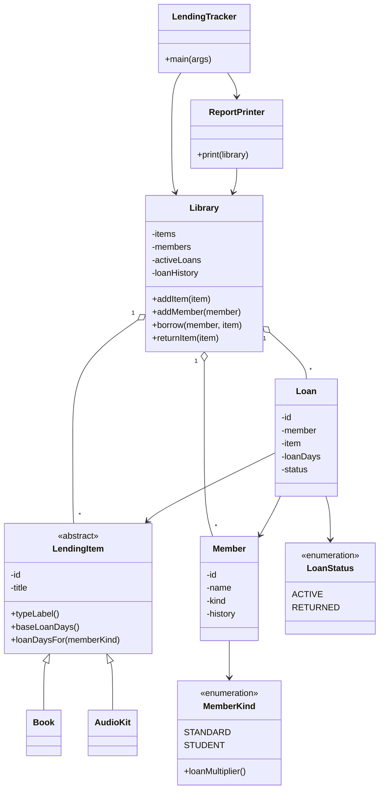

# Diagnosis: The Reading Room lending tracker

## 1. What running it showed

Before reading the code, I ran the program:

```
Lent "Things Fall Apart" to Kofi Mensah for 14 days
Lent "French Audio Course" to Ama Owusu for 14 days
Returned "French Audio Course"
Lent "Things Fall Apart" to Ama Owusu for 28 days

=== The Reading Room - end of day ===
Items:
  "Things Fall Apart" (BOOK): ON_LOAN - with Ama Owusu
  "French Audio Course" (AUDIO_KIT): AVAILABLE
Active loans:
  Loan #1: "Things Fall Apart" -> Kofi Mensah
  Loan #3: "Things Fall Apart" -> Ama Owusu
```

"Things Fall Apart" was lent to Ama although Kofi never returned it. The report is then wrong in two ways:

- The items list says the book is with Ama. Kofi, who actually has it, is no longer shown on the item.
- The active loans list shows the same book on loan to two people at once.

## 2. Problems found in the code

Line numbers refer to `src/main/java/LendingTracker.java`.

### 2.1 No availability check before lending

- **Where:** `Library.borrow`, lines 104–125.
- **What happens:** nothing checks whether an item is already on loan before lending it again. `borrow` also never checks that the item or member belongs to the library.
- **Root cause:** "this item is on loan" is recorded in two places: on the item (`status`, `currentBorrower`) and in the list of loans. `borrow` writes to both and reads neither. The item holds one borrower's name, so the second loan overwrites Kofi; the loan list just gets one more entry. Put as a state machine: an item should only move from available to on loan when borrowed, and back when returned. Nothing guards those moves, so a second borrow takes an item that is already on loan and lends it again. A loan's status is unguarded in the same way: it should only ever move from active to returned.
- **Risk to the library:** items that are not available are lent out and recorded as if that were fine. When the book is overdue, the volunteers chase Ama while Kofi has it.

### 2.2 Items and members are identified by name and title, not by ID

- **Where:** `Loan` stores `memberName` and `itemTitle` (lines 69–70); `LendingItem.currentBorrower` stores a name (line 39). Each object has an `id`, but it is not used to link a loan to its item or member.
- **What happens:** two members with the same name cannot be told apart, and neither can two items with the same title. `returnItem` (lines 130–134) closes every active loan with that title, including the loan for a second copy.
- **Root cause:** names and titles are text for people to read. They are not unique. A loan should point at the actual item and member.
- **Risk to the library:** when one copy of a title comes back, the loan for the other copy is closed too. That copy is still out, but nothing says so, and nobody asks for it back.

### 2.3 Silent fall-through and duplicated rules in `borrow`

- **Where:** `Library.borrow`, lines 105–124.
- **What happens:**
  - The lines that record the history entry and the loan (123–124) run for every item, whether or not either `if` branch ran.
  - An item whose type matches neither branch (a typo such as `"Book"`, or a new type) gets an active loan of 0 days, but the item still shows as available and no "Lent" message is printed.
  - Setting the status, setting the borrower and printing are copied into each branch. The loan periods are bare numbers, with "students get double" written by hand in each branch.
- **Root cause:** the rules for every item type live in one method, in one `if / else if` chain.
- **Risk to the library:** changing one type's rules means editing the method every other type depends on, and nothing reports a mistake. This is the kind of structure behind the volunteers' story that changing the audio-kit rules broke how book returns worked. Adding e-loans would mean a third copy of the branch in the same place.

### 2.4 Broken encapsulation

- **Where:** public fields on `LendingItem`, `Member` and `Loan`; the public `items` and `members` lists; `getLoans()` (lines 138–140); the static ID counters (lines 41, 57, 73).
- **What happens:** the classes do not own their state. Any code can change an item's status, a loan or an ID counter directly. `getLoans()` returns the live private list, so even the private data can be changed from outside (a leaked reference).
- **Root cause:** fields are public where they should be private. A class should own its state and expose methods for changing it.
- **Risk to the library:** a new volunteer's code could write `item.status = "AVAILABLE"` or call `getLoans().clear()`, and the records would be wrong with no error. It also means a check added to `borrow` could still be bypassed.

### 2.5 Strings used for values with a fixed set of options

- **Where:** item type (line 37), item status (line 38), member kind (line 54), loan status (line 72).
- **What happens:** each has a small fixed set of valid values but is stored as free text. A misspelt value compiles and runs.
- **Root cause:** the valid values exist only in comments, so the compiler cannot check them.
- **Risk to the library:** a mistyped item type leads straight into the fall-through in 2.3; a mistyped member kind quietly gives a student the standard loan period. Enums would make an invalid value impossible to write.

### 2.6 Nothing can refuse or report a failure

- **Where:** `borrow` (line 104) and `returnItem` (line 127). Both return `void` and throw nothing.
- **What happens:** every call appears to succeed. `returnItem` prints "Returned" even for an item that was never on loan.
- **Root cause:** there is no error handling: no exceptions and no result values.
- **Risk to the library:** the volunteer gets a success message for something that should have been refused, so mistakes are found late or never. The fix for 2.1 needs a way to say no.

### 2.7 Rules and console output are mixed, and there are no tests

- **Where:** `borrow`, `returnItem` and `printReport` all print from inside `Library`. The project has no test folder.
- **What happens:** one class stores the data, decides the rules and prints. The only way to check a change is to run the program and read the output by eye.
- **Root cause:** `Library` has several jobs, and the rules cannot be checked separately from the printing.
- **Risk to the library:** nothing tells a volunteer whether a change broke something else. This is a main reason new volunteers are told not to touch the code.

### 2.8 The data structures do not fit the data

- **Where:** the three lists on `Library` (lines 87–89).
- **What happens:** every collection is an `ArrayList`. The same item can be added twice, nothing can be looked up by ID, and finding an item's active loan means scanning every loan ever made.
- **Root cause:** the structures were not chosen to match the rules. A list will hold any number of active loans for one item.
- **Risk to the library:** the "one loan per item" rule depends on every piece of code remembering to check, instead of being part of how the data is stored.

### 2.9 Minor notes

- A loan stores its length in days but not the date it started, so the tracker cannot say what is due or overdue.
- A return is not written to the member's history, and the history is free-text sentences.
- Nothing guards against bad input, such as a `null` member or an empty title.
- Fields that never change, such as `id` and `title`, are not `final`.
- Everything is in one file in the default package, with a wildcard import.

## 3. The most dangerous problem

The most dangerous problem is [2.1](#21-no-availability-check-before-lending): an item can be lent while it is already on loan.

- **It is the one rule the library says must never be broken**, and it is being broken now.
- **It happens in normal use.** It needs no typo and no coding mistake, only two people asking for the same book.
- **It destroys what the tool is for.** A lending tracker has to answer "who has this item?". After a double loan the answer is wrong, and the library can lose the item.

All the problems, ranked by what they cost this library, most serious first:

| Rank | Problem | Kind of risk | What it costs the library |
| --- | --- | --- | --- |
| 1 | [2.1 No availability check](#21-no-availability-check-before-lending) | Records are wrong today | The wrong person is recorded as holding an item |
| 2 | [2.2 Identity by name and title](#22-items-and-members-are-identified-by-name-and-title-not-by-id) | Records are wrong today | A return closes the wrong loan, and an item still out is forgotten |
| 3 | [2.4 Broken encapsulation](#24-broken-encapsulation) | A fix would not hold | Any code can change the records and bypass a check in `borrow` |
| 4 | [2.6 Nothing can refuse](#26-nothing-can-refuse-or-report-a-failure) | A fix would not hold | Invalid requests print a success message |
| 5 | [2.8 Data structures](#28-the-data-structures-do-not-fit-the-data) | A fix would not hold | The data itself allows two loans for one item |
| 6 | [2.3 Fall-through and duplicated rules](#23-silent-fall-through-and-duplicated-rules-in-borrow) | Changing the code is dangerous | One type's change can break another, silently |
| 7 | [2.7 Mixed output, no tests](#27-rules-and-console-output-are-mixed-and-there-are-no-tests) | Changing the code is dangerous | Nothing tells a volunteer what they broke |
| 8 | [2.5 Strings for fixed values](#25-strings-used-for-values-with-a-fixed-set-of-options) | Changing the code is dangerous | A typo gives the wrong loan rules with no error |
| 9 | [2.9 Minor notes](#29-minor-notes) | Minor | Nothing on its own |

2.3 ranks sixth for today, but it is the most dangerous for the change that is coming: adding e-loans means editing the one method where every rule lives.

So the rebuild has to do more than add one `if`. It has to leave a single place that knows whether an item is on loan, and a single class that is allowed to change it.

## 4. Planned structure



What each class owns:

- **`LendingTracker`**: only `main`, which runs the same sequence of borrows and returns as the original.
- **`Library`**: the items, the members, the active loans and the full loan history, all private. `borrow` and `returnItem` are the only code that can create or close a loan.
- **`LendingItem`**, with **`Book`** and **`AudioKit`**: each item type is its own class. It states its base loan period (14 days for a book, 7 for an audio kit) and the label the report prints for it (`BOOK`, `AUDIO_KIT`). The item no longer stores a status or a borrower; the report takes both from the active loans.
- **`Member`** and **`MemberKind`**: the member's identity, kind and history. The history keeps one entry per borrow, as in the original, but can only be read from outside. Each kind carries a loan multiplier: 1 for standard, 2 for student.
- **`Loan`** and **`LoanStatus`**: one loan, holding the actual `Member` and `LendingItem`. Its status is an enum that can only move one way, from active to returned. The only change it allows is being marked as returned, which `Library` does when the item comes back. Nothing can set it to any other value, or back to active. The item has no status of its own, so the two can never disagree.
- **`ReportPrinter`**: the end-of-day report, in the same layout as the original.

How this answers the diagnosis:

- **One source of truth ([2.1](#21-no-availability-check-before-lending)).** An item is on loan if, and only if, it has an entry in the active loans. `borrow` checks this first and, if the item is already on loan, refuses: no loan, no history entry and no "Lent" message.
- **Real references ([2.2](#22-items-and-members-are-identified-by-name-and-title-not-by-id)).** A return closes the loan for that exact item.
- **Rules per type ([2.3](#23-silent-fall-through-and-duplicated-rules-in-borrow)).** The loan period is the item's base days times the member kind's multiplier, which gives the original 14/28 and 7/14. `Library` only talks to `LendingItem`, so a new type such as an e-loan is one new class that states its base days and, if its rules differ, its own loan-period calculation.
- **Private state ([2.4](#24-broken-encapsulation))** and **enums ([2.5](#25-strings-used-for-values-with-a-fixed-set-of-options))**: the rules cannot be bypassed or mistyped. Making the fields private is not enough on its own: if a loan's status could still be set directly, a second loan for the same item would be one call away. So the only ways to change who has an item are `borrow` and `returnItem`, and each checks the rule before it changes anything.
- **Refusals ([2.6](#26-nothing-can-refuse-or-report-a-failure)).** Lending an item that is already on loan throws an exception. `main` catches it, prints a refusal message in place of the "Lent" line, and carries on to the report. This is the only request the rebuild refuses. The other invalid requests in 2.1 and 2.6 (an unregistered item or member, returning an item that is not on loan) behave as in the original, because the brief allows one change in behaviour.
- **Separate output ([2.7](#27-rules-and-console-output-are-mixed-and-there-are-no-tests)).** The rules can be checked without reading the console, which makes tests possible.
- **Structures that fit ([2.8](#28-the-data-structures-do-not-fit-the-data)).** Items and members go in maps keyed by ID. Active loans go in a map keyed by item, so an item has at most one. Every loan, active or returned, also stays in a list in the order it was made. The item map and the loan list keep that order, so the report lists items and loans in the same order as the original.

How the loan period is worked out:

- There is one multiplier, and it belongs to the member kind: 1 for standard, 2 for student. The 2 is taken from the existing code, where the student period is double the standard one for both item types.
- By default, the loan period is the item's base days times the member kind's multiplier. `loanDaysFor(memberKind)` on `LendingItem` does this calculation.
- Changing a member kind's multiplier changes the loan period for every item type that uses the default calculation.
- An item type with different rules replaces `loanDaysFor` with its own calculation (for example, an e-loan could give every member the same fixed period). No other class changes.

Planned improvement beyond the brief: due dates.

- Each loan will store the date the item was borrowed. The due date is that date plus the loan period, calculated automatically, so nobody enters it by hand.
- A loan is overdue when its due date is before today's date. Today's date is passed in, so the result can be tested.
- This is new behaviour, so it is added after the rebuild is finished, as a separate view listing overdue loans with the earliest due date first. The original report stays unchanged.
- "Which loan is due soonest?" is the kind of question a heap answers well, so a `PriorityQueue` ordered by due date is an option here. It is not a fit for the active loans in general, which need lookup by item, removal of any loan on return, and listing in the order they were made.
- At this library's size, sorting the active loans by due date when the view is printed is simpler and just as fast, so that is what I plan to do.

If the design changes while building, the design notes will say what changed and why.
